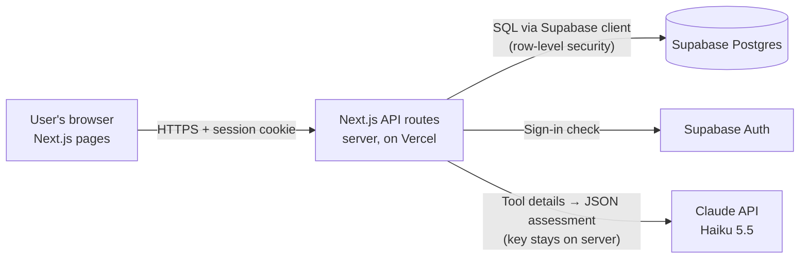

# GovForge — Architecture (V1)

Decisions behind this: [002 stack](decisions/002-stack-nextjs.md) · [003 database](decisions/003-database-supabase.md) · [004 AI](decisions/004-ai-claude-haiku.md) · [005 sign-in](decisions/005-signin-supabase-auth.md) · [006 risk floor](decisions/006-risk-floor-rules.md) · [Tech spec: AI assessment](tech-spec-ai-assessment.md)

## Overview

**In plain English**
1. **Frontend** (Next.js pages in the browser): the forms and the register table. It never talks to Claude and never sees the API key.
2. **Backend** (Next.js API routes on the server): checks you're signed in, validates input, saves to the database, and calls Claude.
3. **Database** (Supabase Postgres): stores organizations, tools and assessments. Row-level security rules mean a query can only ever return rows from your own organization.
4. **AI** (Claude API): receives tool details, returns a JSON assessment. The backend validates it before anything is saved.

**Why saving never depends on the AI:** saving a tool (`POST /api/tools`) and assessing it (`POST /api/tools/{id}/assess`) are separate requests. If Claude is down, the first still works.

## Data model

### `organizations`
| Field | Type | Notes |
|---|---|---|
| id | uuid | Primary key |
| name | text | One row in V1 |
| created_at | timestamp | |

### `members`
| Field | Type | Notes |
|---|---|---|
| user_id | uuid | Links to Supabase Auth user; primary key |
| org_id | uuid | → organizations.id |
| display_name | text | Shown as "owner" |
| created_at | timestamp | |

### `tools`
| Field | Type | Notes |
|---|---|---|
| id | uuid | Primary key |
| org_id | uuid | → organizations.id; used by row-level security |
| name | text | Required; unique per organization (case-insensitive) → duplicate warning |
| vendor | text | Optional |
| purpose | text | Required |
| team | text | Optional |
| data_types | text[] | Required; at least one (e.g. "Client data", "Personal data", "Public info") |
| owner_id | uuid | → members.user_id; set to whoever adds it |
| created_at | timestamp | "Date added" |
| updated_at | timestamp | "Last updated" |
| data_types_changed_at | timestamp | Used to mark older assessments "Out of date" |

### `assessments`
| Field | Type | Notes |
|---|---|---|
| id | uuid | Primary key |
| tool_id | uuid | → tools.id |
| org_id | uuid | → organizations.id |
| status | text | `complete` or `insufficient_info` |
| risk_level | text | `Low` / `Medium` / `High`; empty if insufficient info |
| reasons | jsonb | 3–5 strings |
| controls | jsonb | 3–5 strings |
| missing_info | jsonb | What to add, when status is `insufficient_info` |
| inputs_snapshot | jsonb | Exact tool details sent to the AI ("inputs used") |
| model | text | e.g. `claude-haiku-5-5`, for traceability |
| created_by | uuid | → members.user_id |
| created_at | timestamp | "Date assessed" |
| override_level | text | Reviewer's level, if overridden |
| override_reason | text | Required when overriding |
| overridden_by | uuid | → members.user_id |
| overridden_at | timestamp | |

A tool's **current assessment** is its newest row. It's **Out of date** when the tool's current name, vendor, purpose or data types differ from `inputs_snapshot` (tech spec 3.6; `data_types_changed_at` no longer needed). Extra columns (`ai_level`, `floor_level`, `floor_reason`, `prompt_version`, `duration_ms`) are in the [tech spec](tech-spec-ai-assessment.md#38-data-model-changes-assessments-migration-003_assessmentssql). Keeping old rows means "assessment history" (a Should) is nearly free later.

*Added in Stage 7:* an `events` table for tracking (assessment created, register viewed).

## API endpoints (REST)

All endpoints require sign-in. Not signed in → **401**.

| Method + path | What it does | Success | Errors |
|---|---|---|---|
| `GET /api/tools` | List the register with each tool's current assessment, sorted High → Not assessed | 200 | 401 |
| `POST /api/tools` | Add a tool | 201 Created | 400 missing/invalid field · 409 duplicate name |
| `GET /api/tools/{id}` | One tool with its current assessment | 200 | 404 not found (or other org) |
| `PATCH /api/tools/{id}` | Edit a tool | 200 | 400 · 404 · 409 duplicate name |
| `POST /api/tools/{id}/assess` | Run the AI assessment | 201 (complete or insufficient info) | 404 · 502 AI unavailable/invalid output · 504 over 60 s |
| `PATCH /api/assessments/{id}/override` | Reviewer override with reason | 200 | 400 missing reason/invalid level · 404 |

## Environment variables

| Name | Where it's used | Secret? |
|---|---|---|
| `NEXT_PUBLIC_SUPABASE_URL` | Browser + server | No (public by design) |
| `NEXT_PUBLIC_SUPABASE_ANON_KEY` | Browser + server | No (public by design; row-level security protects data) |
| `ANTHROPIC_API_KEY` | Server only | **Yes** — `.env.local` locally, Vercel settings in production |

The `NEXT_PUBLIC_` prefix tells Next.js it's safe to send to the browser. Anything without it stays on the server.
